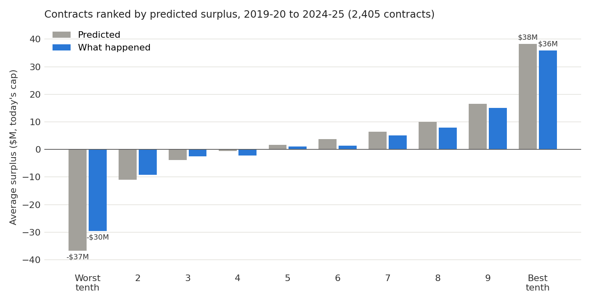

# Market Value — NBA salary vs. the market's price for a player's profile

A machine-learning model trained on a decade of NBA contracts (2015–16 → 2025–26) that learns how the
league *prices* a statistical profile, then flags which players sit off the market curve — and uses SHAP
to explain, in dollars, exactly which skills move them there.

This is a **market-pricing** model, not a player-value model. It answers *"is this player paid what the
market pays players with his profile?"* — not *"is he worth it?"* The distinction matters (see below).

---

## The question it answers

Most public NBA salary work is **normative**: it computes what a player *should* earn from an impact metric
(e.g. DARKO × minutes × cost-of-a-win), then calls the gap "over/underpaid." That answers *worth*.

This model is **descriptive**: it learns the league's actual pricing function from real contracts, with no
impact metric in the loop — built entirely from raw production. The residual (actual − predicted) is then
*market deviation*: who's paid above or below their statistical comparables. A player flagged "underpaid"
isn't necessarily good value; he's paid less than the market pays players who do what he does.

That makes it fully reproducible end-to-end (no dependency on a third-party black-box metric) and lets it
answer a question impact models can't: **net of minutes and scoring, which skills does the market pay a
premium for?**

## Results

- **R² = 0.845** on an out-of-time test (train ≤ 2021–22, test 2023–24 onward) — forecasting seasons the
  model never saw, not fitting in-sample.
- **MAE ≈ $3.7M** on salaries that range to ~$60M.
- The top features are the *obvious* ones — experience, minutes, scoring, draft pedigree, All-NBA credential.
  That's the evidence the model learned the real market: a salary model whose top drivers *weren't* the
  obvious ones would be broken. The novel findings live in the tail (rim/interior defense, shot creation,
  trajectory) and in the per-player residuals.

## How it's built

- **Data:** a custom NBA stats pipeline (~1,000 features per player-season: box score, tracking, play-type,
  shot-location, clutch, defense), plus a from-scratch scrape of accurate historical salaries from
  Basketball-Reference, and All-NBA selections parsed from BBR's award tables.
- **Target:** salary as a share of that season's cap (`pct_cap`) — cap-era-comparable.
- **Feature engineering:**
  - **Temporal lag features** with a consecutive-season gap-mask — each player's prior-1 and prior-2 season
    production. This is the single biggest accuracy gain (0.79 → 0.85), and the model learns the decay rate
    itself (prior year ≈ 3× the weight of two-years-ago). It lets the model tell a rising player from a
    fading one, and an injured star from a declined one.
  - **Weighted All-NBA credential** (1st-team = 3, 2nd = 2, 3rd = 1), prior seasons only — the signal that
    separates max-tier stars from merely good players (and matches CBA supermax logic).
  - **Availability** (games played, total minutes) and **max-tier eligibility** by experience.
- **Model:** LightGBM with early stopping, a mechanical pre-filter (near-constant / near-empty / |r|>0.95
  collinear), then importance- and SHAP-based interpretation.
- **App:** Streamlit + Plotly, reading precomputed artifacts (no model at runtime). Two views — a per-player
  SHAP waterfall (what moves this player's price, in dollars) and a sortable league ladder.

## What it gets right — and a worked example

The most-overpaid and most-underpaid lists pass the smell test: dead-money contracts (declining or injured
stars on max deals) surface as overpaid; veterans on minimums and discounts surface as underpaid.

**Giannis Antetokounmpo, 2025–26** is the model in one chart. Every factor says max-tier — experience, prior
healthy minutes, All-NBA résumé, scoring — all pushing his price up. A single bar pulls it down: this
season's minutes, because he played 36 games. The model correctly reads "elite player, injury-discounted
season," landing him modestly below his actual max. The injury, isolated in one bar.

## Limitations (by design, not bugs)

A market model built on individual box-score production has structural blind spots, and naming them is part
of the analysis:

- **Role / relational value is invisible.** Glue defenders and spacers (e.g. champion role players) get
  paid for fit and scheme value that doesn't appear in *their own* stat line, so they can read as overpaid.
- **Injury seasons read as overpaid.** A contract signed on prior healthy years meets a current injured
  season; the lag features soften this but a *contemporaneous* model can't fully resolve it.
- **Breakout seasons read as underpaid** — the exact flip side of the injury fix. The lag features anchor a
  player to recent history, which a breakout, by definition, contradicts (e.g. a Most-Improved guard).
- **The very top is set by credentials and scarcity**, not just production — which is why the All-NBA
  credential feature exists, and why it narrows but doesn't fully close the gap at the ceiling.

## The impact-model comparison

The app ships **two** models side by side. The production model above prices players on their own on-court
output only. The **impact model** is the same feature set plus prior-season LEBRON (a plus-minus impact
metric) and its offensive/defensive role classifications.

This is the direct test of the role-value blind spot: if a player reads as overpaid in the production model
and fairly paid in the impact model, the difference *is* the scheme/fit value his own box score can't see.

## Backtest: did trade value pay off?

The project has grown past the salary model above. `trade_value.py` forecasts what each contract is worth to a
team: the player's projected wins, priced at what the league pays for a win, minus what he is owed (plus title
odds and re-signing rights, which this test leaves out). A forecast like that can't be checked today, so `backtest.py`
makes it in the past, where the answer is known.

**Method.** Stand at the end of each of six seasons (2019-20 to 2024-25). Refit the rating model, aging curve, price
of a win, minutes, rookie growth and availability on that season and earlier. Project every contract up to three seasons
ahead, then compare with the wins each player actually produced, priced the same way. That gives 2,405 contract
forecasts covering 675 players.



| | Trade value | Last season repeated | Salary alone |
|---|---|---|---|
| Correlation with actual surplus | **0.67** (0.61 to 0.72) | 0.57 (0.50 to 0.63) | 0.19 (0.06 to 0.33) |
| Surplus error (RMSE) | **$19.8M** | $24.0M | |
| Wins error, 1 / 2 / 3 seasons ahead (RMSE) | **1.48 / 1.84 / 2.05** | 1.68 / 2.16 / 2.42 | 1.90 / 2.23 / 2.38 |

- **"Last season repeated" is the fair baseline:** it assumes every player keeps producing what he just did. Trade value
  beats it in all six years. The gap in correlation is 0.10 (95% range 0.07 to 0.14).
- **The dollars are close on average.** The best tenth was predicted at $38M and produced $36M; the worst tenth, -$37M
  and -$30M, so it is somewhat harsh on bad contracts. 87% of the best tenth paid off, against 12% of the worst.
- Ranges are 95%, from resampling players, because the same player appears at several starting points. The wins column
  for salary alone is a straight line fitted to the test itself, which flatters it.

**Biggest misses** (surplus over the seasons tested, at most three)

| Too low | Predicted | Actual | Too high | Predicted | Actual |
|---|---|---|---|---|---|
| Gilgeous-Alexander, 2021-22 | -$16M | $178M | Simmons, 2020-21 | $11M | -$126M |
| Gilgeous-Alexander, 2022-23 | $53M | $191M | Morant, 2022-23 | $29M | -$95M |
| Jokic, 2019-20 | $69M | $189M | Embiid, 2022-23 | $20M | -$102M |
| Garland, 2019-20 | -$32M | $77M | Robert Williams III, 2021-22 | $78M | -$27M |

- **Breakouts and superstars come in too low:** the model expects average growth.
- **The big overestimates are mostly players who barely played.** Of the 100 largest one-year misses among players at 24+
  minutes a game, 47 were too high, and 40 of those played under half their games. Adding more games-played history to
  the forecast did not help on held-out seasons, so there is no easy fix in the data used here.
- **Not every addition helped.** Projecting changes in minutes leaves the error unchanged ($19.8M with, $19.6M without).
  Rookie growth brings rookies' average closer ($12.8M predicted against $15.6M; $9.7M without it) but overshoots the
  five best-rated rookies each year ($54M against $48M).

**Limits**

- There are no historical contracts in the data, only salaries. A salary that continues at normal raises is treated as
  the same deal, which uses later seasons and favors players who stayed useful.
- Outcomes come from the same family of rating model, so a blind spot in the rating is invisible here.
- Parameters are refitted as of each date, but the model was designed by someone who had seen these seasons.
- The two earliest starts lack the history to price a win and borrow the next one's price.
- It tests season-end forecasts, not early-season ones.

Hindsight in the design can only be ruled out by forecasting ahead. `frozen.py` saves a dated copy of the award, win-total and
trade-value forecasts each week of 2026-27 in `data/frozen/`, never edited, to be graded after the season.

```python
from backtest import *
bt = run_backtest(df_master)          # ~10 minutes; df_master is the full player-season table (the copy in this repo is out of date)
backtest_summary(bt)
carried_forward(bt, df_master)
calibration_chart(bt, "docs/backtest_calibration.png")
```

## Roadmap

- **Contract-state features.** Salary is set once at signing and then fixed for years, so a residual today
  conflates market error with a stale contract. Adding signing date, contract year, and years remaining —
  and moving the unit of observation from player-season to contract-signing event — is the single biggest
  correctness improvement available.
- **Rookie-scale flag** to separate "underpaid by rule" (CBA draft-slot scale, no market involved) from
  "underpaid by market."
- **Forward validation** against real future contracts (already scraped, 2026–31), including the
  summer-2026 signings.
- **Prediction intervals** (conformalized quantile regression) so the output is "12% of the cap, 90%
  interval 8–17%" rather than a point estimate the width of which is invisible.

## Run locally

```bash
pip install -r requirements.txt
python3 -m streamlit run app.py
```

Reads four precomputed artifacts from `data/`: `app_meta_v2.parquet`, `shap_v2.parquet`,
`app_meta_v2_lebron.parquet`, `shap_v2_lebron.parquet`. No model runs at request time.
